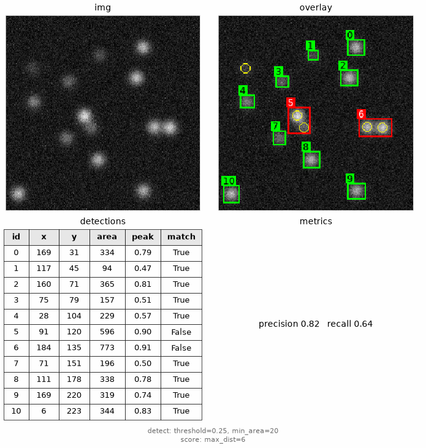
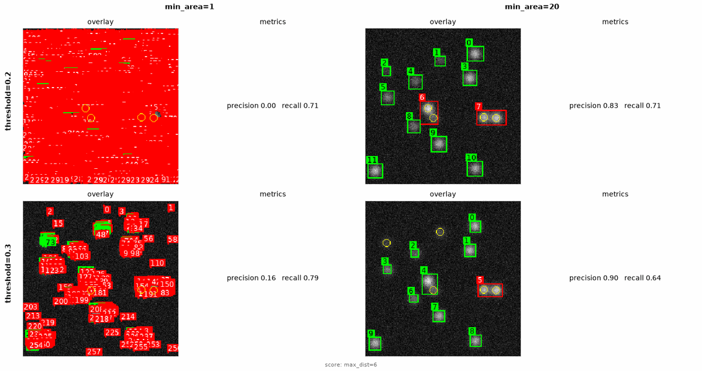
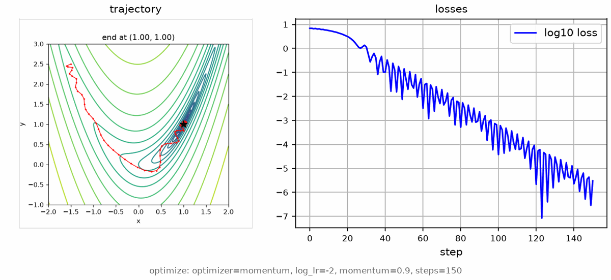
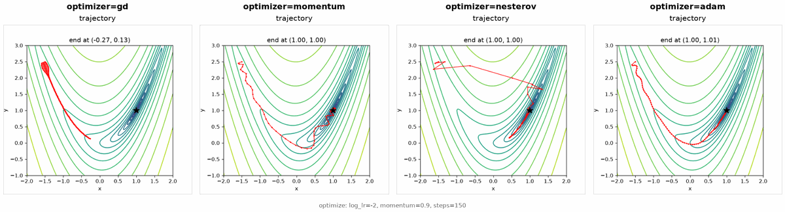
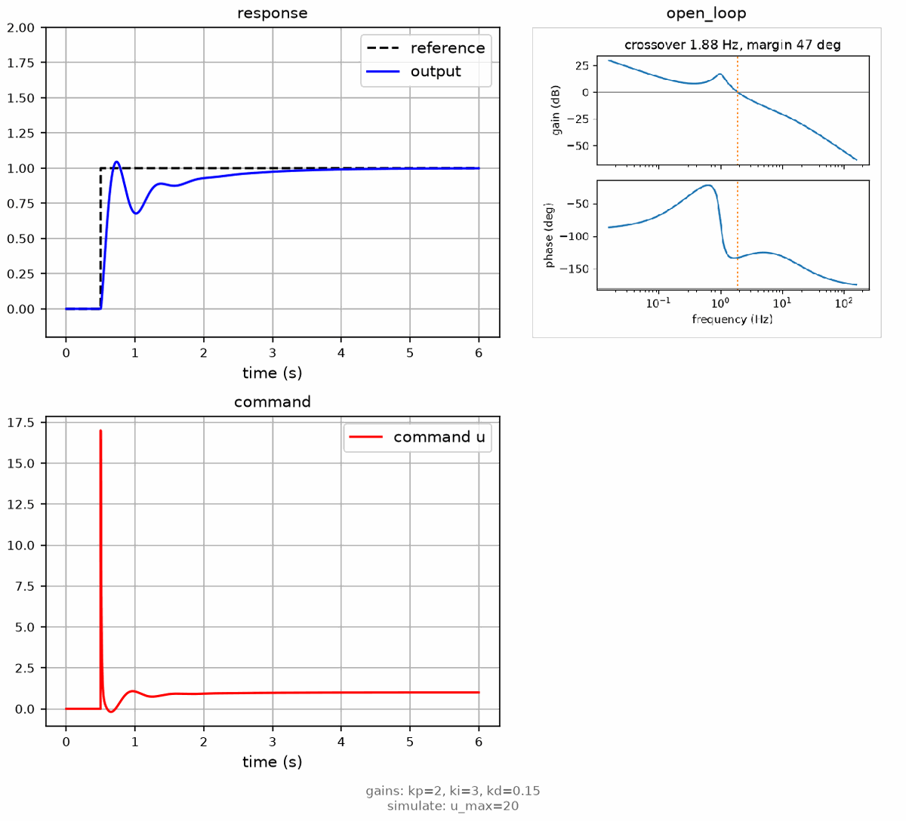
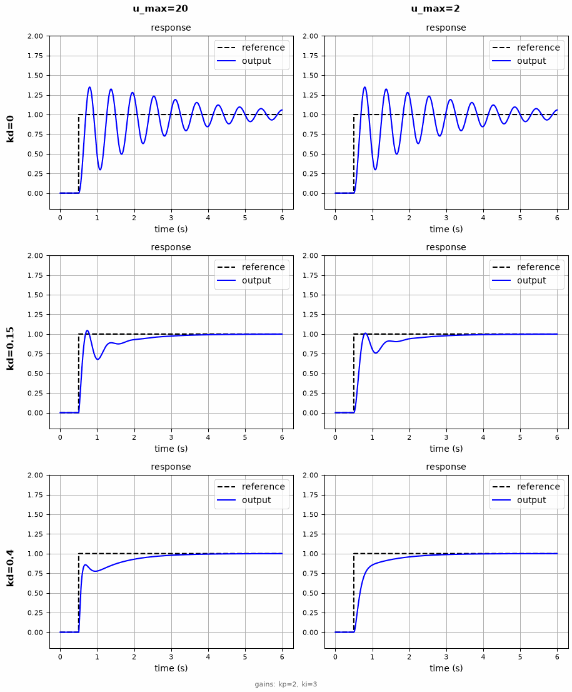

# Scientific gallery

Eight visual-debugging tools for real engineering problems, each one file under `demo/gallery/`, synthetic data only (numpy), runnable as a script (`python demo/gallery/camera_isp.py` opens the GUI). They were written as a newcomer would, from the [agent skill](guide/command-line.md) alone, to find the rough edges of the library.

The images are snapshots (`pipe.snapshot` / `pipe.sweep`), regenerated by `python scripts/make_gallery.py`.

## Camera ISP

Check every stage of a raw-to-RGB chain against the ground truth: a diverging error map with a colorbar shows where demosaicking and white balance go wrong, the PSNR sums it up.


??? example "demo/gallery/camera_isp.py"

    ``` { .python }
    --8<-- "demo/gallery/camera_isp.py"
    ```

## Frequency-domain filtering

Place a band-pass mask (one range slider for both radii) on the log-spectrum and see what each band of frequencies contributes to the image; a matplotlib figure gives the radial power profile.


??? example "demo/gallery/frequency_filtering.py"

    ``` { .python }
    --8<-- "demo/gallery/frequency_filtering.py"
    ```

## 1D signal filtering

Compare a windowed-sinc FIR and a Butterworth IIR low-pass on a noisy chirp: time is frequency, so the filtered curve fades out at the cutoff; the Bode plot shows magnitude and phase on twin axes.


??? example "demo/gallery/signal_filtering.py"

    ``` { .python }
    --8<-- "demo/gallery/signal_filtering.py"
    ```

## Detection overlay

Tune a threshold + connected-components detector: boxes drawn with `interactive_pipe.draw` (green true positives, red false positives, yellow misses), a table of detections and precision / recall.



The sweep chose the defaults: a low threshold needs a minimal area to reject noise specks.



??? example "demo/gallery/blob_detection.py"

    ``` { .python }
    --8<-- "demo/gallery/blob_detection.py"
    ```

## Optimisation trace

Watch gradient descent, momentum, Nesterov and Adam cross the Rosenbrock valley: contour figure with the trajectory, loss curve, a `Literal` dropdown for the optimiser and a log10 learning-rate slider.



One sweep over the dropdown compares the four optimisers at the same learning rate.



??? example "demo/gallery/optimizer_trace.py"

    ``` { .python }
    --8<-- "demo/gallery/optimizer_trace.py"
    ```

## Lens calibration

Recover radial distortion coefficients by eye: the corrected checkerboard straightens and the residual vectors (from each true corner) shrink; the RMS is in the cell title.


??? example "demo/gallery/lens_calibration.py"

    ``` { .python }
    --8<-- "demo/gallery/lens_calibration.py"
    ```

## PID control

Tune a PID on a lightly damped second-order plant: step response and command as curves, open-loop Bode plot with crossover and phase margin; the three gains come from one filter so that both the simulation and the Bode plot use the same sliders.



The sweep shows what the derivative gain and actuator saturation do to the step response.



??? example "demo/gallery/pid_control.py"

    ``` { .python }
    --8<-- "demo/gallery/pid_control.py"
    ```

## Stateful simulation (edge case)

A Gray-Scott reaction-diffusion animated by a clock. Pipelines are pure functions of their controls, simulations are not: the frame is made a function of the clock (`t`) with the context as a cache, so snapshots and sweeps stay reproducible.


??? example "demo/gallery/reaction_diffusion.py"

    ``` { .python }
    --8<-- "demo/gallery/reaction_diffusion.py"
    ```
