# Scientific gallery

Sixteen visual-debugging tools for real engineering problems, each one file under `demo/gallery/`, synthetic data only (numpy), runnable as a script (`python demo/gallery/camera_isp.py` opens the GUI). They were written as a newcomer would, from the [agent skill](guide/command-line.md) alone, to find the rough edges of the library: eight in a first round, eight more (`g2_*.py`, [second round](#second-round)) once those were fixed.

The images are snapshots (`pipe.snapshot` / `pipe.sweep`), regenerated by `python scripts/make_gallery.py`.

## Camera ISP

Check every stage of a raw-to-RGB chain against the ground truth: a diverging error map with a colorbar shows where demosaicking and white balance go wrong, the PSNR sums it up.

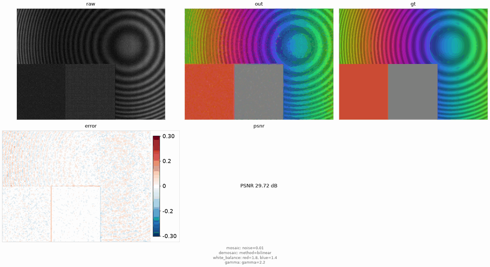

??? example "demo/gallery/camera_isp.py"

    ``` { .python }
    --8<-- "demo/gallery/camera_isp.py"
    ```

## Frequency-domain filtering

Place a band-pass mask (one range slider for both radii) on the log-spectrum and see what each band of frequencies contributes to the image; a matplotlib figure gives the radial power profile.

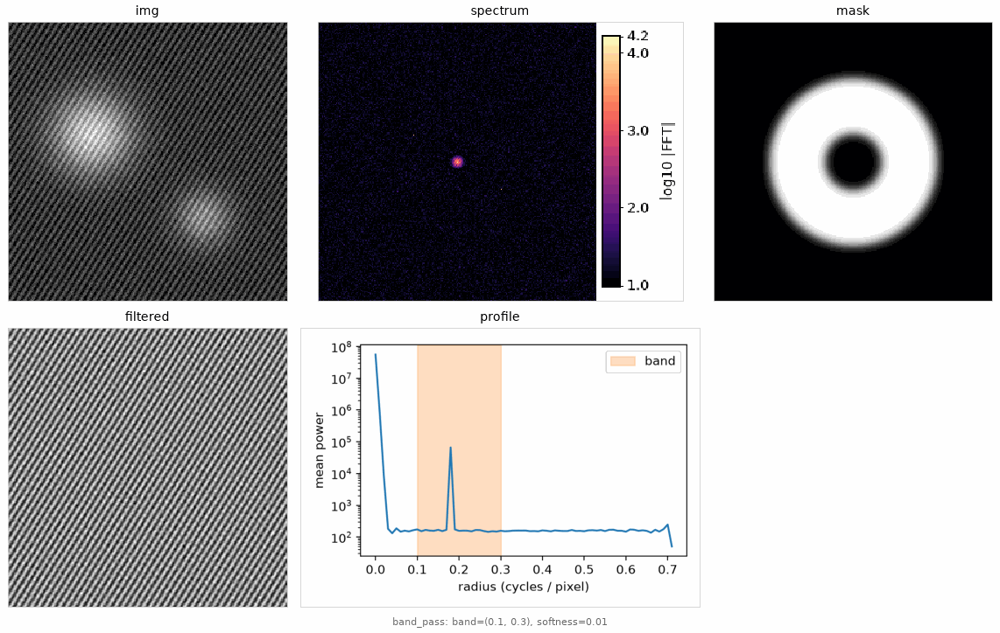

??? example "demo/gallery/frequency_filtering.py"

    ``` { .python }
    --8<-- "demo/gallery/frequency_filtering.py"
    ```

## 1D signal filtering

Compare a windowed-sinc FIR and a Butterworth IIR low-pass on a noisy chirp: time is frequency, so the filtered curve fades out at the cutoff; the Bode plot shows magnitude and phase on twin axes.

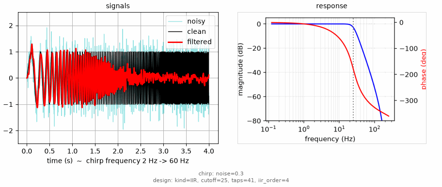

??? example "demo/gallery/signal_filtering.py"

    ``` { .python }
    --8<-- "demo/gallery/signal_filtering.py"
    ```

## Detection overlay

Tune a threshold + connected-components detector: boxes drawn with `interactive_pipe.draw` (green true positives, red false positives, yellow misses), a table of detections and precision / recall.


The sweep chose the defaults: a low threshold needs a minimal area to reject noise specks.


??? example "demo/gallery/blob_detection.py"

    ``` { .python }
    --8<-- "demo/gallery/blob_detection.py"
    ```

## Optimisation trace

Watch gradient descent, momentum, Nesterov and Adam cross the Rosenbrock valley: contour figure with the trajectory, loss curve, a `Literal` dropdown for the optimiser and a log-scale learning-rate slider.


One sweep over the dropdown compares the four optimisers at the same learning rate.


??? example "demo/gallery/optimizer_trace.py"

    ``` { .python }
    --8<-- "demo/gallery/optimizer_trace.py"
    ```

## Lens calibration

Recover radial distortion coefficients by eye: the corrected checkerboard straightens and the residual vectors (from each true corner) shrink; the RMS is in the cell title.

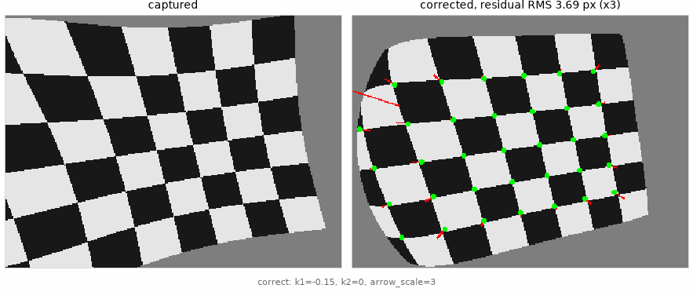

??? example "demo/gallery/lens_calibration.py"

    ``` { .python }
    --8<-- "demo/gallery/lens_calibration.py"
    ```

## PID control

Tune a PID on a lightly damped second-order plant: step response and command as curves, open-loop Bode plot with crossover and phase margin; the three gains come from one filter so that both the simulation and the Bode plot use the same sliders.


The sweep shows what the derivative gain and actuator saturation do to the step response.


??? example "demo/gallery/pid_control.py"

    ``` { .python }
    --8<-- "demo/gallery/pid_control.py"
    ```

## Stateful simulation (edge case)

A Gray-Scott reaction-diffusion animated by a clock. Pipelines are pure functions of their controls, simulations are not: the state lives in `context` and each run advances it to the clock (`t`); snapshots and sweeps start each picture from a fresh context, so they stay reproducible.

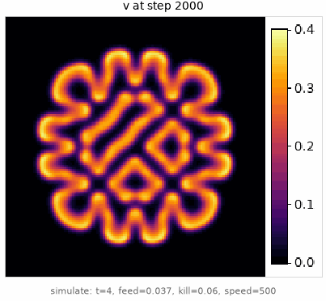

??? example "demo/gallery/reaction_diffusion.py"

    ``` { .python }
    --8<-- "demo/gallery/reaction_diffusion.py"
    ```

## Second round

Eight more examples, written the same way after the first round's fixes.

## Stereo block matching

Block matching on a random-dot stereo pair: disparity and diverging error heatmaps with colorbars against the ground truth, a `PointControl` probe on the left view that plots the matching cost of one pixel.

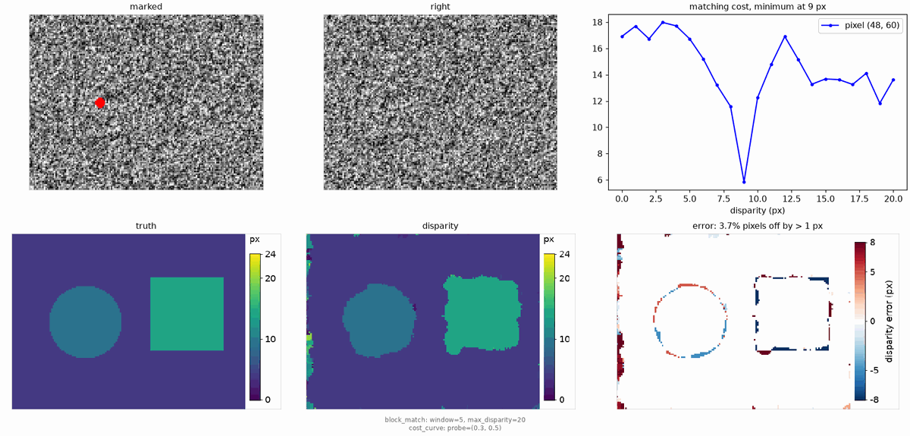

A larger window trades noise for blurred edges (the error concentrates on the depth discontinuities).

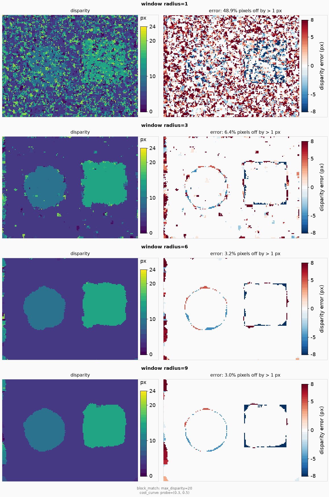

??? example "demo/gallery/g2_stereo_matching.py"

    ``` { .python }
    --8<-- "demo/gallery/g2_stereo_matching.py"
    ```

## Segmentation

Threshold or k-means segmentation of a noisy synthetic scene: `draw.mask` overlay with the mean IoU in its title, a confusion `Table`, and a `RegionControl` on the overlay feeding a histogram figure with the thresholds.

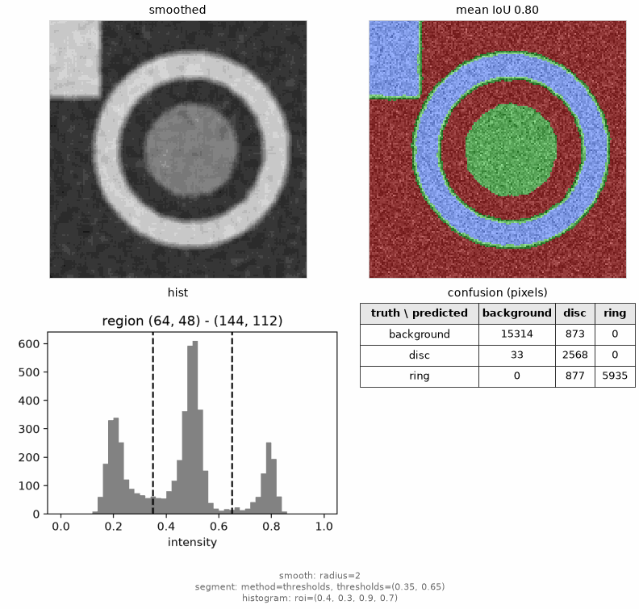

??? example "demo/gallery/g2_segmentation.py"

    ``` { .python }
    --8<-- "demo/gallery/g2_segmentation.py"
    ```

## Kalman tracking

Constant-velocity and constant-acceleration Kalman filters on a track that turns: trajectory figure, normalised innovation `Curve`, RMS table. One log slider each for q and r drives both filters (a shared `Control`).

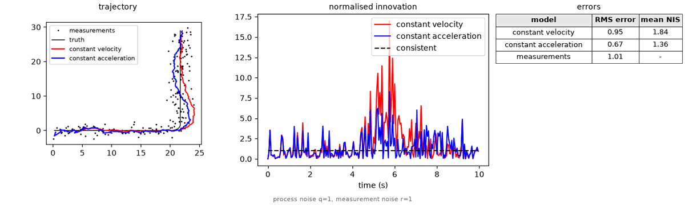

Too little process noise and the constant-velocity filter cannot follow the turn; around q = 100 both agree.

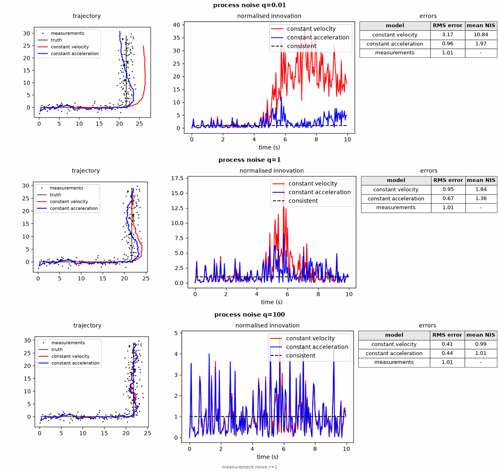

??? example "demo/gallery/g2_kalman_tracking.py"

    ``` { .python }
    --8<-- "demo/gallery/g2_kalman_tracking.py"
    ```

## Beamforming

Array factor of a steered uniform linear array: polar figure with the beam width and side-lobe level in the title, and a heatmap of the array factor versus element spacing with its axes (`layout.style(extent=..., xlabel=..., ylabel=...)`) where the grating lobes appear.

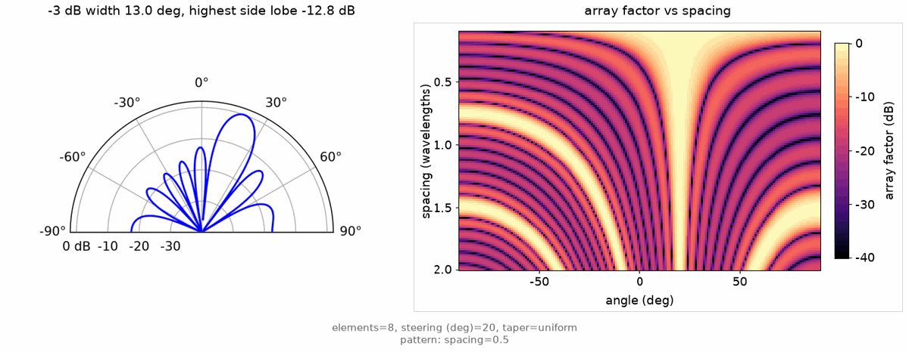

A Hann taper lowers the side lobes; more elements narrow the beam.

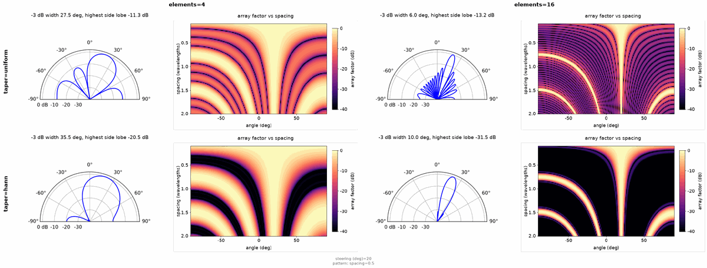

??? example "demo/gallery/g2_beamforming.py"

    ``` { .python }
    --8<-- "demo/gallery/g2_beamforming.py"
    ```

## DCT compression

8x8 block DCT with a quality slider shared by the codec and the rate-distortion curve: reconstruction, diverging error heatmap, rate-distortion `Curve` and table; a checkbox zeroes the high frequencies.

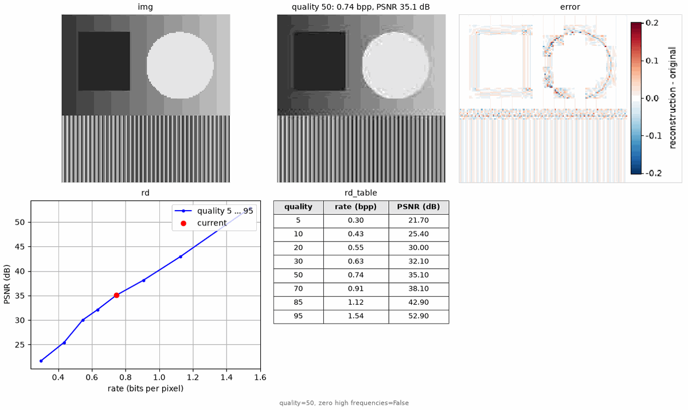

The blocking artefacts and the error on the stripes fade as the quality rises.

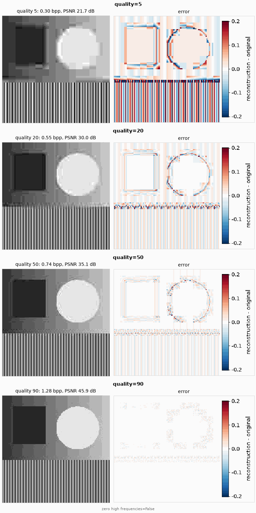

??? example "demo/gallery/g2_dct_compression.py"

    ``` { .python }
    --8<-- "demo/gallery/g2_dct_compression.py"
    ```

## Heat diffusion

An explicit 2D heat equation stepped by a slider; the solver state is cached in `context` keyed on the controls, so moving the step forward continues the simulation while snapshots stay reproducible.

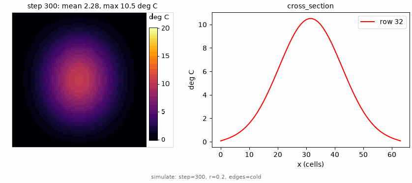

Cold edges drain the heat, insulated edges keep the mean temperature.

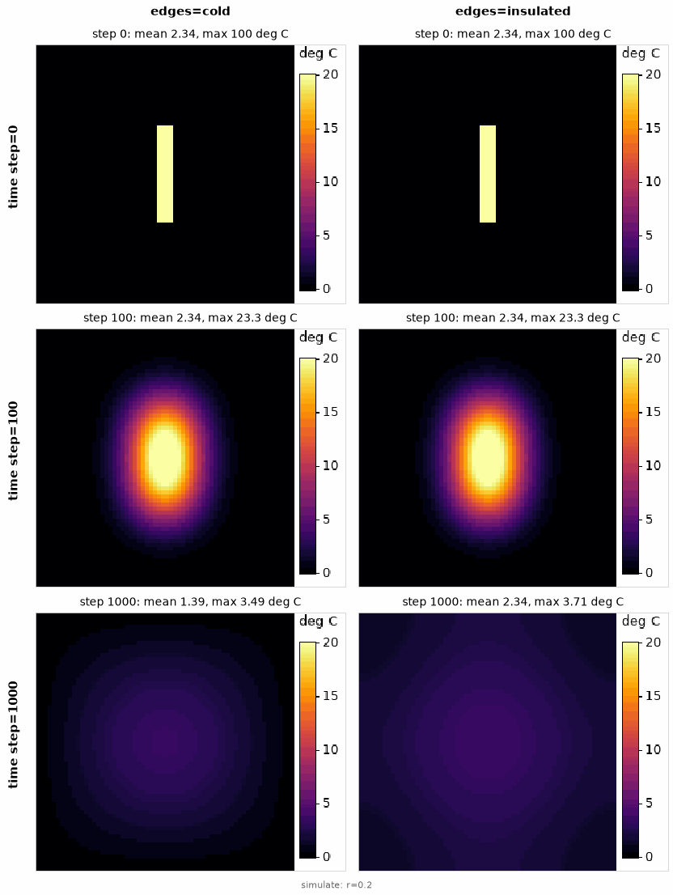

??? example "demo/gallery/g2_heat_diffusion.py"

    ``` { .python }
    --8<-- "demo/gallery/g2_heat_diffusion.py"
    ```

## Training curves

Loss curves of a learning-rate sweep: metric dropdown (`Literal`), exponential smoothing, a log-scale checkbox (`Curve(yscale="log")`), the best run in the title and a summary table; an empty selection shows an empty plot and table.

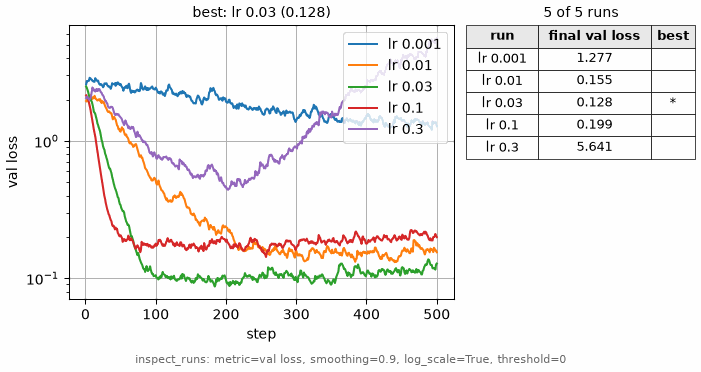

Unsmoothed, the last value names the wrong run best; smoothing ranks lr 0.03 first.

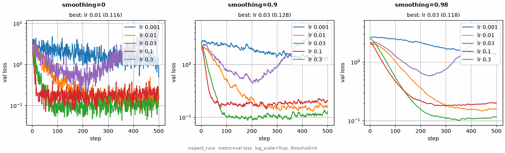

??? example "demo/gallery/g2_training_curves.py"

    ``` { .python }
    --8<-- "demo/gallery/g2_training_curves.py"
    ```

## Audio effects

A guitar-pedal chain (distortion, low-pass, delay) on a synthetic chord: waveform and spectrum `Curve`s, a spectrogram with time and frequency axes, and the result played in the Qt window with `audio.set(signal, sample_rate)`.

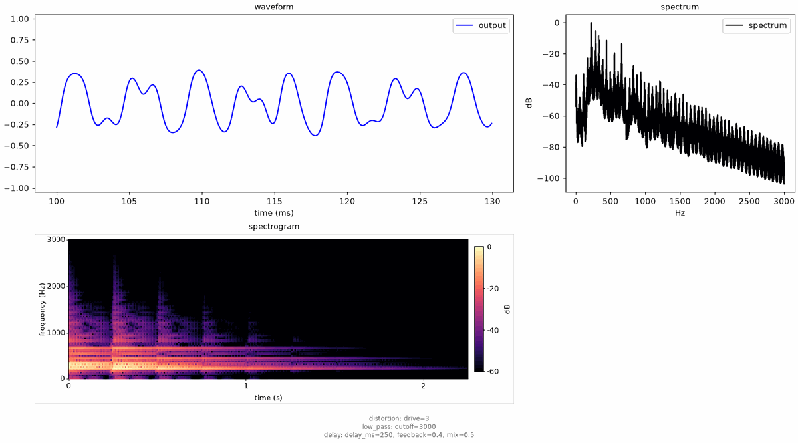

The feedback of the delay repeats the attack every 250 ms.

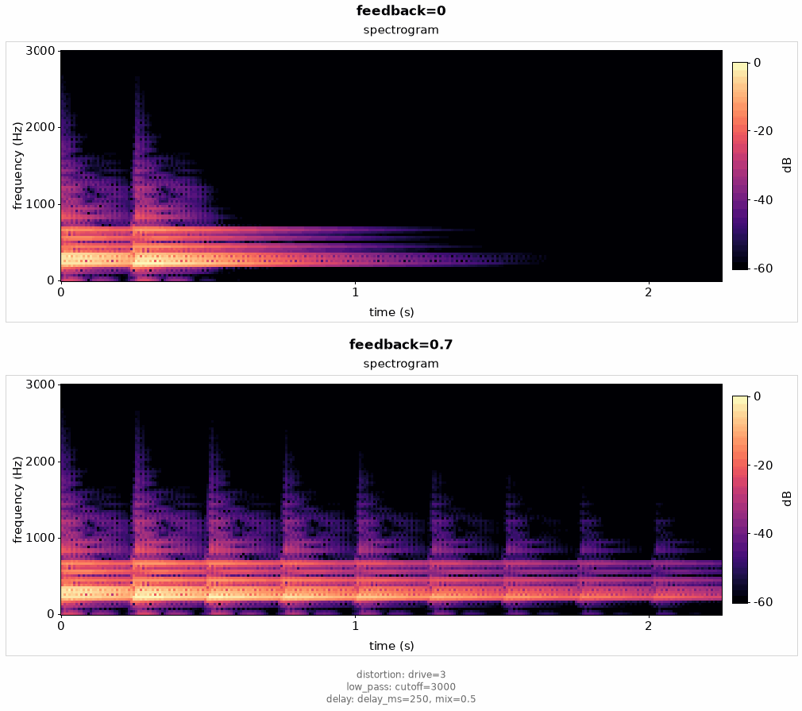

??? example "demo/gallery/g2_audio_effects.py"

    ``` { .python }
    --8<-- "demo/gallery/g2_audio_effects.py"
    ```
