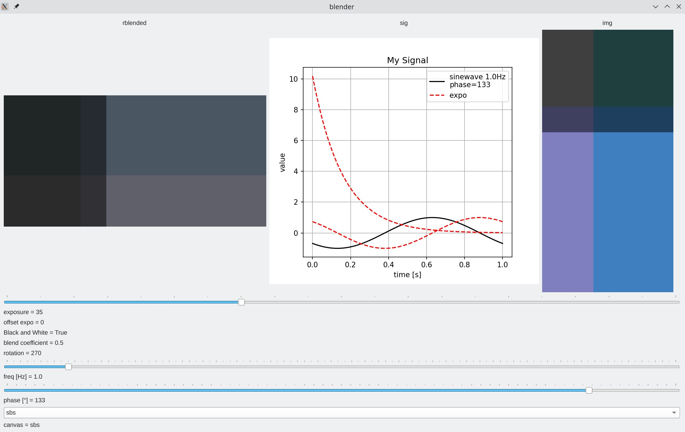
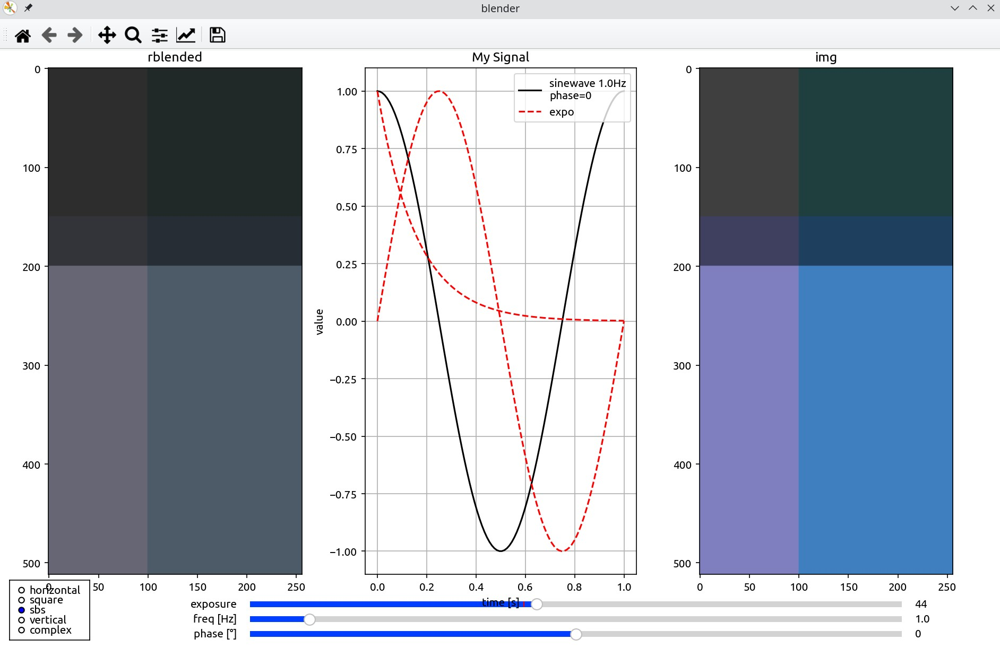
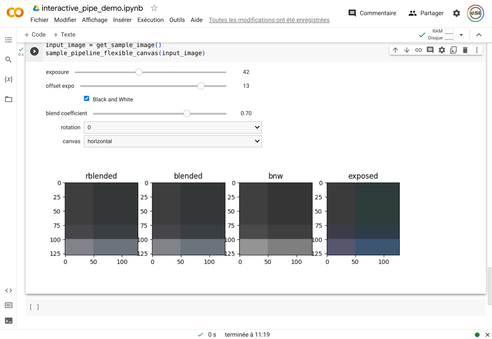
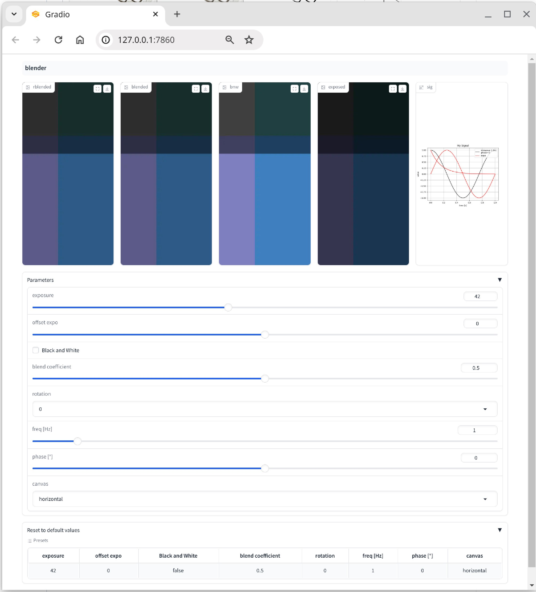

# Backends

Select the backend with the `gui=` argument of `@interactive_pipeline` (or `@interact`): a string, a `Backend` enum value, or `None` for headless mode.

```python
@interactive_pipeline(gui="qt")      # PyQt / PySide window
@interactive_pipeline(gui="dpg")     # Dear PyGui window (GPU rendered)
@interactive_pipeline(gui="mpl")     # matplotlib figure
@interactive_pipeline(gui="nb")      # Jupyter notebook widgets (works on Colab)
@interactive_pipeline(gui="gradio")  # web app (local only, no public share link)
@interactive_pipeline(gui="auto")    # best available backend
@interactive_pipeline(gui=None)      # headless: returns a HeadlessPipeline
```

## Feature matrix

| ⭐ | *PyQt / PySide* | *Dear PyGui* | *Matplotlib* | *Jupyter notebooks incl. Google Colab* | *Gradio* |
|:-----:|:-----:|:-----:|:------:|:----:|:----:|
| Backend name | `qt` | `dpg` | `mpl` | `nb` | `gradio` |
| Preview |  | ➖ |  |  |  |
| Plot curves | ✅ | ✅ (zoom & pan) | ✅ | ✅ | ✅ |
| Change layout | ✅ | ✅ | ✅ | ✅ | ➖ |
| Keyboard shortcuts / fullscreen | ✅ | ✅ | ✅ | ➖ | ➖ |
| Menu bar | ✅ | ✅ | ➖ | ➖ | ➖ |
| Audio support | ✅ | ➖ | ➖ | ➖ | ✅ |
| Image buttons | ✅ | ✅ | ➖ | ➖ | ➖ |
| Circular slider | ✅ | ✅ (knob) | ➖ | ➖ | ➖ |
| Collapsible panels | ✅ | ✅ | ➖ | ➖ | ✅ |
| Animations | ✅ | ✅ | ➖ | ➖ | ➖ |
| Panels with sliders | ✅ | ✅ | ➖ | ➖ | ✅ |
| Detached panels | ✅ | ✅ | ➖ | ➖ | ➖ |
| Tables | ✅ | ✅ | ✅ | ✅ | ✅ |
| [matplotlib figures](../guide/figures-and-overlays.md) (as images) | ✅ | ✅ | ✅ | ✅ | ✅ |
| [Heatmaps with colorbar](../guide/figures-and-overlays.md#heatmaps-with-a-colorbar) | ✅ (scalar readout) | ✅ | ✅ | ✅ | ✅ |
| [Drawing on images](../guide/figures-and-overlays.md#drawing-on-images-interactive_pipedraw) (`draw`) | ✅ | ✅ | ✅ | ✅ | ✅ |
| Image viewer (fit / zoom / pan / pixel readout) | ✅ | ➖ no pixel readout | ➖ | ➖ | ➖ |
| Status line (timings, errors) | ✅ | ✅ | ➖ | ➖ | ➖ |

Controls degrade gracefully: for example a [`KeyboardControl`](../guide/keyboard.md) maps back to a regular slider on the gradio and notebook backends, and a `CircularControl` falls back to a straight slider outside Qt and Dear PyGui. A [`RangeControl`](../guide/controls.md#range-control) gets a two-handle slider on every backend.

## Dear PyGui

`gui="dpg"` renders the window with [Dear PyGui](https://github.com/hoffstadt/DearPyGui) (`pip install "interactive-pipe[dpg]"`), an immediate-mode GPU toolkit that stays responsive with large images and fast refresh rates. It supports the same declarative features as Qt — panels at any position, collapsible and detached panels, keyboard shortcuts, `TimeControl` animations, image buttons and knobs for `CircularControl` — with native, zoomable plots for curve outputs and native tables. Images are scaled uniformly to fill the window (resize it to taste, or pass `size=(w, h)` / `"fullscreen"` / `"maximized"`); as on Qt, the mouse wheel zooms around the cursor, left-drag pans, double-click fits back, keys 0 / 1 / + / - switch to fit / 100% / zoom, and zoom & pan are synced across cells. Audio playback is not available on this backend.

## Gradio

`gui="gradio"` serves the pipeline as a web page (`pip install "interactive-pipe[gradio]"`, Python 3.10+). It is a **single-user app**: every browser tab drives the same pipeline, controls and results, and requests are served one at a time. Public share links are disabled: `share_gradio_app=True` is ignored (a warning is logged). Pass extra [`launch`](https://www.gradio.app/docs/gradio/blocks#blocks-launch) arguments with `gradio_launch_kwargs`. A public link has to be requested explicitly, ideally with a login:

```python
@interactive_pipeline(gui="gradio", gradio_launch_kwargs={"share": True, "auth": ("me", "a long password")})
```

Anyone who can open the page can set every control, including free-text ones, and sees what the previous visitor loaded: share it only with people you trust.

## Headless

`gui=None` (or `"headless"`) skips the GUI entirely and returns a `HeadlessPipeline`: the same pipeline code serves interactive tuning and batch processing, and it is what you want in unit tests. See the [Quickstart](quickstart.md#headless-mode-same-code-no-gui).

## Choosing the backend from the command line or the environment

Switch backend or window size without editing your script.

### Command line: `-b`, with no code

Any script whose pipeline keeps the default `gui="auto"` accepts `-b` / `--backend` (alias `--gui`):

```bash
python my_script.py -b mpl
python my_script.py --backend=dpg
python my_script.py -b headless        # runs once without a window
```

The decorator only peeks at `sys.argv`: it does not parse or consume the command line, so your own argument handling is untouched (if you use `argparse`, declare the option with `add_gui_arguments` below so it is not rejected as unknown). A value that is not a backend name is ignored, so a script that uses `-b` for something else (say `-b 32`) is not affected. An explicit `gui="qt"` in the decorator is never overridden.

### Command line: `interactive_pipe.cli`

`parse_gui_args()` adds `-b` / `--backend` / `--gui {auto,qt,dpg,mpl,nb,gradio,headless}`, `--fullscreen`, `--maximized`, `--size WxH` and `--name` to an `argparse` parser and returns the parsed arguments together with the keyword arguments for `interactive_pipeline`. Only the options actually given end up in those kwargs, so with no flags you get `interactive_pipeline()` with all its defaults.

```python
from interactive_pipe import interactive_pipeline
from interactive_pipe.cli import parse_gui_args

args, gui_kwargs = parse_gui_args()
demo = interactive_pipeline(**gui_kwargs)(my_pipeline)  # gui="auto" unless --gui given
demo(img)
```

```bash
python my_script.py --gui dpg --size 1280x800
python my_script.py --fullscreen --name "Exposure tuning"
python my_script.py --gui headless     # gui=None: returns a HeadlessPipeline
```

To mix in your own options, pass your parser (`parse_gui_args(parser=my_parser)`), or call `add_gui_arguments(my_parser, defaults={"gui": "qt"})` then `gui_kwargs_from_args(my_parser.parse_args())`. `--fullscreen`, `--maximized` and `--size` are mutually exclusive; an invalid `--size` exits with a usage error.

### Environment variables

| Variable | Values | Effect |
|---|---|---|
| `INTERACTIVE_PIPE_GUI` | `auto`, `qt`, `dpg`, `mpl`, `nb`, `gradio`, `headless` / `none` | Replaces `gui` when the decorator uses `gui="auto"` (the default). `headless`/`none` returns a `HeadlessPipeline`. |
| `INTERACTIVE_PIPE_SIZE` | `fullscreen`, `maximized`, `WxH` (e.g. `1280x800`) | Window size when the decorator was not given a `size`. |

```bash
INTERACTIVE_PIPE_GUI=mpl INTERACTIVE_PIPE_SIZE=maximized python my_script.py
```

The variables are read when `interactive_pipeline` decorates the function. An invalid value raises `ValueError`. `INTERACTIVE_PIPE_GUI` also applies to `@interact`, except `headless`, which `@interact` ignores. `INTERACTIVE_PIPE_SIZE` is not applied to `@interact`. Not every backend accepts every size: the notebook backend only takes `(w, h)`, and Matplotlib has no `maximized`.

### `-b nb` from a terminal

The notebook backend draws its widgets in Jupyter. Started from a terminal (`python my_script.py -b nb`, or `gui="nb"`), it asks whether to write a notebook next to the script (`my_script.ipynb`) and open it: the notebook runs the script with the same arguments from the current folder (and with the same interactive_pipe, a source tree included), and JupyterLab (else the classic Notebook) is started with the same Python, so the kernel sees the same packages. When Jupyter is not installed, the notebook is still written and the commands to install and open it are printed. A notebook not generated by interactive_pipe is never overwritten. Answering no, or a non-interactive run, keeps the previous behaviour.

### Precedence

1. Command-line helper values: they are passed to the decorator as explicit arguments.
2. Explicit decorator arguments: any `gui` other than `"auto"` (including `gui=None`), and any `size`.
3. Environment variables.
4. Defaults: automatic backend selection, backend-specific window size.
