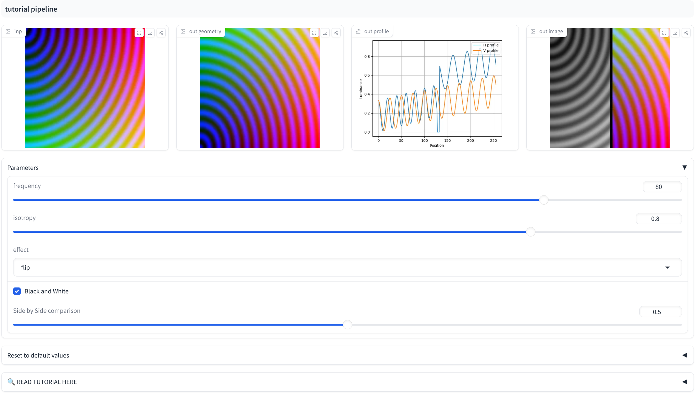
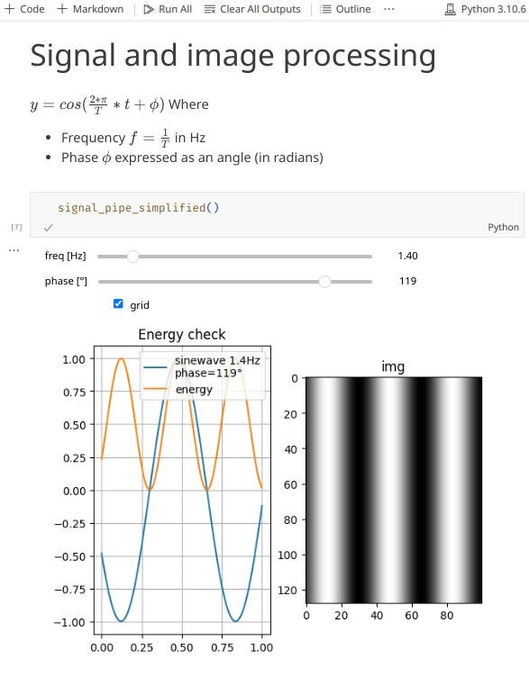
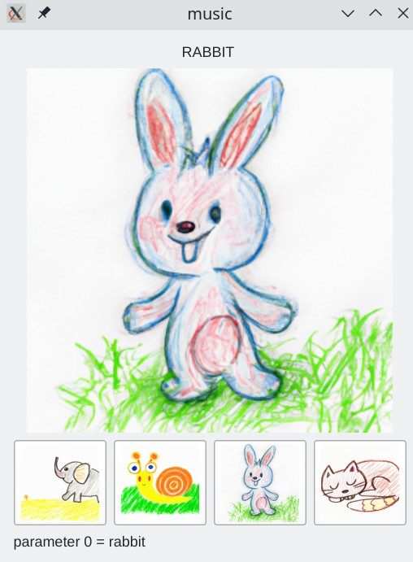
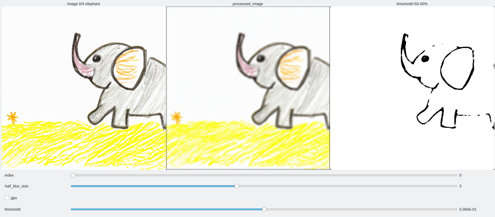
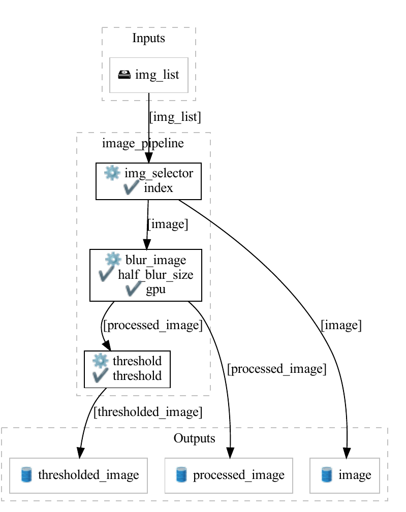
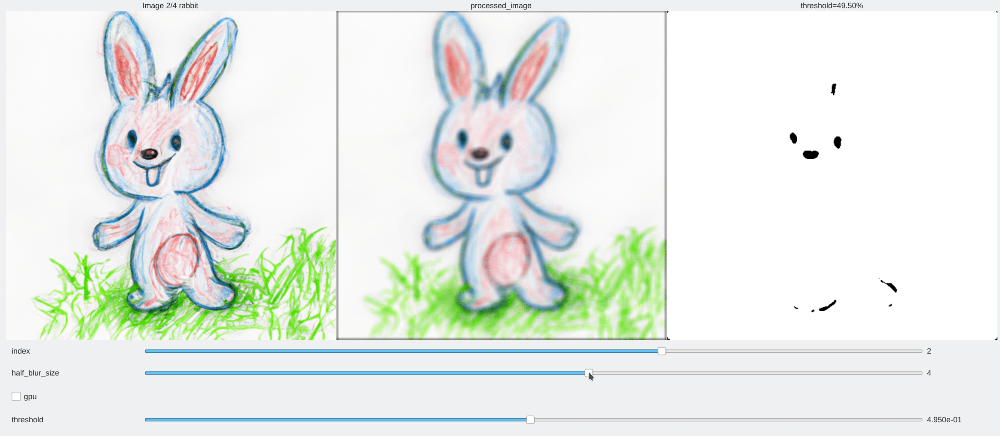
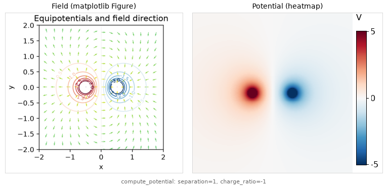
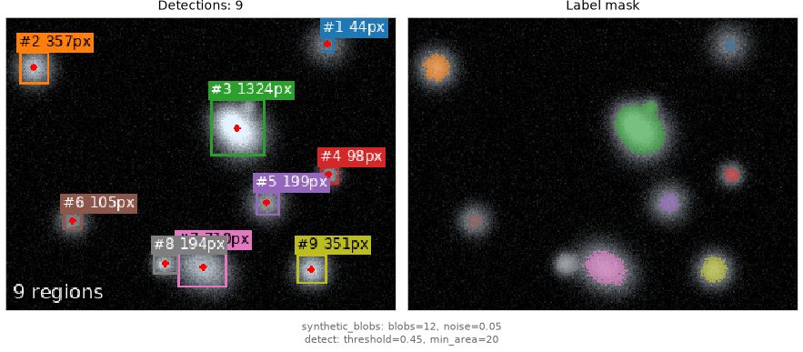
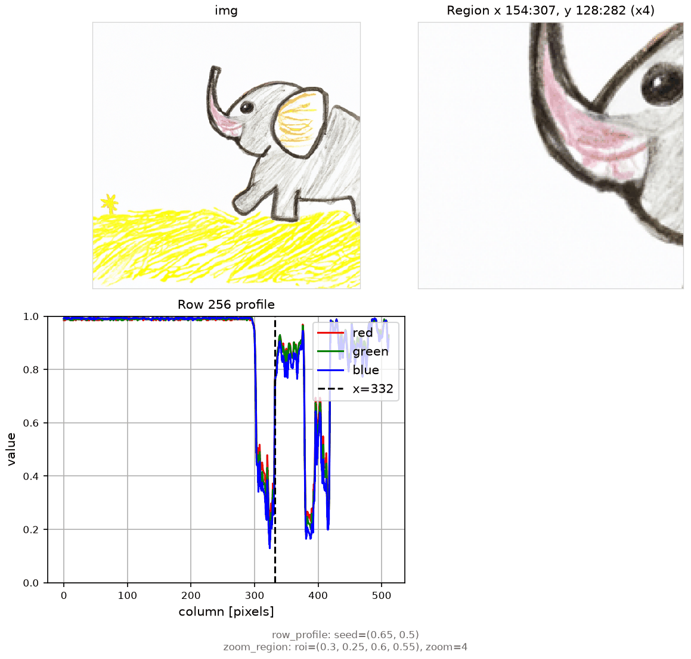

# Examples gallery

## Tutorials

- **[Main tutorial on Hugging Face](https://huggingface.co/spaces/balthou/interactive-pipe-tutorial)** — interactive, runs in the browser
- [Tutorial in a Colab notebook](https://colab.research.google.com/github/livalgo/interactive-pipe-examples/blob/main/interactive_pipe_tutorial.ipynb)
- [Quickstart as a Colab notebook](https://colab.research.google.com/drive/1PZn8P_5TABVCugT3IcLespvZG-gxnFbO?usp=sharing) (ipywidgets backend)
- [Speech exploration notebook](https://colab.research.google.com/drive/1mUX2FW0qflWn-v3nIx90P_KvRxnXlBpz#scrollTo=qDTaIwvaJQ6R) — signal processing in a notebook

## Showcase

| Science notebook | Toddler DIY jukebox on a Raspberry Pi |
|:-----:|:-----:|
|  |  |
| Sliders appear automatically in a Jupyter notebook — works on Google Colab, ~40 lines of code. | Plays music when a toddler touches an icon; image buttons + audio on Qt. |
| [Demo notebook on Colab](https://colab.research.google.com/drive/1AwHyjZH8MnzZqwsvbmxBoB15btuMIwtk?usp=sharing) | [jukebox_demo.py](https://github.com/balthazarneveu/interactive_pipe/blob/master/demo/jukebox_demo.py) |

### Multi-image pipeline

The main demo: [demo/multi_image.py](https://github.com/balthazarneveu/interactive_pipe/blob/master/demo/multi_image.py)

| GUI | Pipeline graph |
|:--:|:--:|
|  |  |

## Demo scripts

All in [`demo/`](https://github.com/balthazarneveu/interactive_pipe/tree/master/demo):

| Script | Shows |
|---|---|
| `multi_image.py` (+ `.ipynb`) | The main tutorial pipeline: selection, exposure, blending |
| `widgets_showcase.py` | Every widget type in one app |
| `button_demo.py` | Image buttons |
| `color_demo.py` | Dropdown-driven color generation |
| `colored_checkerboard_rotation_demo.py` | `CircularControl` rotation |
| `panel_demo.py` / `grouped_controls_demo.py` | [Panel system](panels.md) |
| `panel_position_demo.py` / `detached_panel_demo.py` | Panel placement and detached windows |
| `key_event_demo.py` | Key-bound one-shot [events](keyboard.md#key-bound-one-shot-events) |
| `time_wave_demo.py` / `time_physics_demo.py` | `TimeControl` animations |
| `video_grading_demo.py` | Grade a video file with a [timeline](video.md); the timecode in a title |
| `video_motion_demo.py` | Motion detection on a numpy video, temporal `window=` ([video](video.md#temporal-filters-window)) |
| `video_compare_demo.py` | A torch model checked against a reference: two videos at different frame rates on one timeline |
| `video_raw_sequence_demo.py` | A RAW burst in a custom file format (`loader=`): per-frame exposure and white balance metadata remove the flicker; embedded previews as thumbnails (`thumbnail_loader=`), read-ahead (`--slow --preload 24`) ([video](video.md#custom-formats-and-per-frame-metadata)) |
| `webcam_demo.py` | A cartoon effect tuned live on the [webcam](webcam.md) (`--synthetic` without a camera) |
| `image_editing_demo.py` / `image_analysis_demo.py` | Realistic image workflows |
| `independent_curve_image_demo.py` | Mixing `Curve` plots and images |
| `table_demo.py` | `Table` outputs |
| `matplotlib_figure_demo.py` | matplotlib `Figure` outputs and a heatmap with colorbar ([figures](figures-and-overlays.md)) |
| `overlay_demo.py` | Detections drawn with [`interactive_pipe.draw`](figures-and-overlays.md#drawing-on-images-interactive_pipedraw) |
| `pointer_demo.py` | Mouse input: a clicked point and a dragged region ([mouse input](mouse-input.md)) |
| `jukebox_demo.py` | Raspberry Pi jukebox (audio + image buttons) |
| `audio_processing_demo.py` | Switch between a voice and a music clip, add noise, denoise, pitch-shift, A/B listen ([`interactive_pipe.sound`](audio.md#audio-helpers-interactive_pipesound)) |

Every demo also runs without a display: `interactive-pipe snapshot demo/table_demo.py` writes what its window would show to a PNG, `interactive-pipe check demo/table_demo.py` reports its outputs and problems (the test suite snapshots every demo and sample, see [Snapshots](snapshots.md) and the [command line](command-line.md)).

| `matplotlib_figure_demo.py` | `overlay_demo.py` | `pointer_demo.py` |
|:--:|:--:|:--:|
|  |  |  |

## Scientific gallery

Sixteen visual-debugging tools for engineering problems in [`demo/gallery/`](https://github.com/balthazarneveu/interactive_pipe/tree/master/demo/gallery), synthetic data only, each with its picture and source on the [scientific gallery](../gallery.md) page:

| Script | Shows |
|---|---|
| `camera_isp.py` | Raw-to-RGB chain against the ground truth: error heatmap with a colorbar, PSNR in the title |
| `frequency_filtering.py` | Band-pass mask on the log-spectrum (`RangeControl`), radial power profile figure |
| `signal_filtering.py` | FIR vs IIR low-pass on a chirp, Bode plot |
| `blob_detection.py` | Threshold detector: boxes drawn with `draw`, a table of detections, precision / recall |
| `optimizer_trace.py` | Gradient descent, momentum, Nesterov and Adam on Rosenbrock: trajectory figure, loss curve |
| `lens_calibration.py` | Radial distortion recovered by eye: corrected checkerboard and residual vectors |
| `pid_control.py` | PID step response and Bode plot, one set of sliders shared by two filters |
| `reaction_diffusion.py` | Gray-Scott simulation driven by a clock, kept reproducible for snapshots |
| `g2_stereo_matching.py` | Block matching: disparity and error heatmaps with colorbars, `PointControl` probe on a cost curve |
| `g2_segmentation.py` | `draw.mask` overlay, confusion `Table`, IoU in the title, `RegionControl` on a histogram figure |
| `g2_kalman_tracking.py` | Two Kalman filters, one log slider each shared by both, trajectory figure, innovation `Curve` |
| `g2_beamforming.py` | Polar figure, heatmap with axes (`layout.style(extent=...)`) of the array factor vs spacing |
| `g2_dct_compression.py` | Block DCT, diverging error heatmap, rate-distortion curve and table, shared quality slider |
| `g2_heat_diffusion.py` | Stateful simulation stepped by a slider, `context` cache keyed on the controls |
| `g2_training_curves.py` | `Literal` metric, smoothing, log scale (`Curve(yscale="log")`), empty selection shown |
| `g2_audio_effects.py` | Effect chain, waveform and spectrum curves, spectrogram with axes, `audio.set(signal, rate)` |

## Curated samples

The [`samples/`](https://github.com/balthazarneveu/interactive_pipe/tree/master/samples) folder walks through the declaration styles:

- `decorated_pipeline.py` — decorator syntax with explicit `Control` objects
- `decorated_pipeline_abbreviated.py` — the abbreviated tuple declarations
- `object_oriented_pipeline_declarations.py` — pipeline graph built by hand, no decorators
- `interact_sample/` — a small filter library + `@interact` one-shot GUI + its pytest suite
