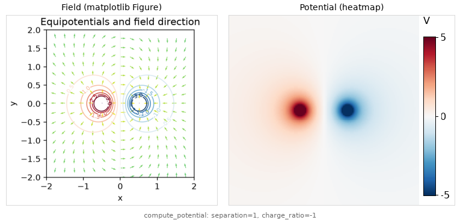
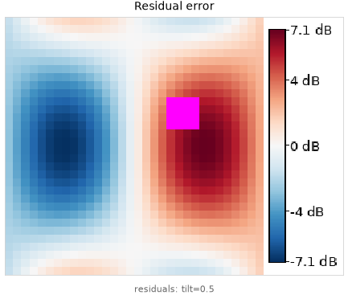
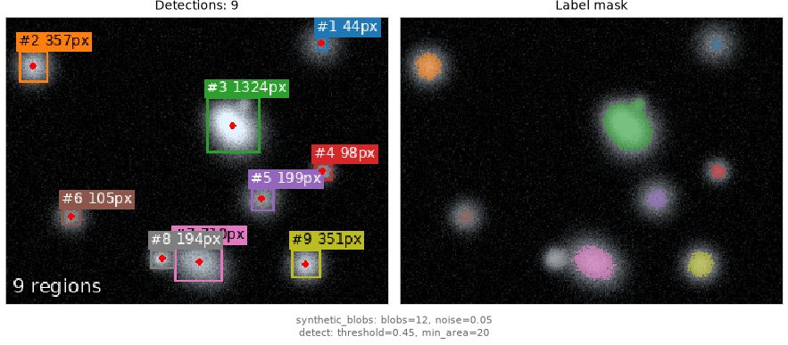

# Figures, heatmaps and overlays

Three things scientific and engineering debugging needs, each one line in a
filter and identical on every backend (Qt, Dear PyGui, matplotlib, notebook,
Gradio), in [`snapshot` / `sweep`](snapshots.md), in `save()` and in
`export_animation`:

- **any matplotlib figure** you already know how to make, returned as is;
- **heatmaps with a readable scale**: colormap, colorbar, diverging range;
- **marks drawn on an image**: detections, keypoints, regions, labels, with
  `interactive_pipe.draw`.

## matplotlib figures

A filter may return a `matplotlib.figure.Figure` — or, as a convenience, an
`Axes` (its figure is shown). Use it for anything a [`Curve`](curves.md)
cannot draw: contours, quiver and stream plots, polar plots, histograms with
annotations, several subplots...

```python
import numpy as np
from matplotlib.figure import Figure

from interactive_pipe import interactive, interactive_pipeline, layout


@interactive(freq=(2.0, [0.5, 5.0]), turns=(3, [1, 8]))
def polar_flower(freq=2.0, turns=3):
    theta = np.linspace(0, 2 * np.pi * turns, 2000)
    fig = Figure(figsize=(4, 4))
    ax = fig.add_subplot(projection="polar")  # something a Curve cannot do
    ax.plot(theta, 1 + 0.5 * np.cos(freq * theta), color="tab:red")
    layout.style("flower", title=f"r = 1 + cos({freq:.1f} θ) / 2")
    return fig


@interactive_pipeline(gui="qt")
def flower_pipeline():
    flower = polar_flower()
    return flower
```

- **Build figures with `matplotlib.figure.Figure()`**, not `pyplot`: no
  global state, nothing to close, safe next to any GUI toolkit. A figure made
  with `plt.subplots()` also works: it is closed in `pyplot` as soon as it is
  displayed, so dragging a slider does not pile up figures (a plain headless
  call `pipe(...)` hands the figure back to you and leaves it alone).
- The figure is rasterised with Agg in one shared place and shown as an
  image, so it looks the same everywhere and zooms like any image in the Qt
  and Dear PyGui viewers. The default resolution is 120 dpi (a default
  6.4 x 4.8 in figure gives 768 x 576 pixels); change it per output with
  `layout.style("flower", dpi=200)`.
- An unchanged figure (for instance a cached filter result) is not redrawn.
- `pipe.save("out/result.png")` writes figures with `savefig`: ask for
  `.pdf` or `.svg` to keep vector output.

[`demo/matplotlib_figure_demo.py`](https://github.com/balthazarneveu/interactive_pipe/blob/master/demo/matplotlib_figure_demo.py)
draws the field of two point charges (contours and arrows in a `Figure`)
next to the same potential as a heatmap with a colorbar:



## Heatmaps with a colorbar

Return a 2D `(H, W)` array and describe its display with
[`layout.style`](layout.md#output-style):

| Key | Effect |
|---|---|
| `colormap` | matplotlib colormap name or `Colormap` object. |
| `vmin`, `vmax` | Values mapped to the ends of the colormap; each defaults to the data min / max. |
| `center` | Widens the range to be symmetric around this value: `colormap="RdBu", center=0` for signed data. |
| `colorbar` | `True` draws the scale on the right of the map: min, max and round ticks. |
| `unit` | Text appended to the colorbar labels, e.g. `unit="dB"`. |

```python
import numpy as np

from interactive_pipe import interactive, interactive_pipeline, layout


@interactive(tilt=(0.5, [-1.0, 1.0]))
def residuals(tilt=0.5):
    y, x = np.mgrid[-1:1:32j, -1:1:32j]
    error = 6 * np.sin(3 * x) * np.cos(2 * y) + 4 * tilt * x
    error[10:14, 20:24] = np.nan  # missing measurements
    layout.style("error", title="Residual error", colormap="RdBu_r", center=0, colorbar=True, unit="dB")
    return error


@interactive_pipeline(gui=None)
def heatmap_pipeline():
    error = residuals()
    return error


heatmap_pipeline.snapshot("docs/images/figures_heatmap_colorbar.png")
```



- The colorbar is drawn **into the displayed image**, so it is identical on
  every backend and in snapshots. A small map (like this 32 x 32 one) is
  first enlarged (nearest neighbour, integer factor) so the labels stay
  legible; large maps are not resampled.
- **NaN and masked values** (`numpy.ma`) are shown in **magenta**, a colour
  no common colormap uses, so a missing value never reads as a valid one;
  they are ignored when computing the automatic range. A `Colormap` with
  its own bad colour (`cmap.with_extremes(bad="black")`) uses that colour
  instead. `+inf` / `-inf` go to the ends of the scale.
- **Pixel readout (Qt)**: hovering a heatmap reports the original scalar
  value and its data coordinates, also over an enlarged map with a colorbar
  (nothing is reported over the colorbar itself).
- The pipeline result stays the raw 2D array: `save()` writes the data,
  not the colours.

## Drawing on images: `interactive_pipe.draw`

Small pure functions (numpy + Pillow, no OpenCV) that return a new image with
marks drawn on it:

| Function | Draws |
|---|---|
| `draw.points(img, xy, color=None, radius=3, labels=None, filled=True)` | discs or circles at `(x, y)` points, optional labels |
| `draw.boxes(img, boxes, labels=None, color=None, width=2, fmt="xyxy")` | rectangles `(x0, y0, x1, y1)` (or `fmt="xywh"`: `(x0, y0, width, height)`), labels on a tag above each box |
| `draw.lines(img, lines, color=None, width=2, closed=False)` | one polyline `(M, 2)`, segments `(K, 2, 2)` or a list of polylines |
| `draw.polygon(img, polygons, color=None, width=2, fill_alpha=0)` | closed polygons, optionally filled with a translucent colour |
| `draw.text(img, text, xy, color="white", size=None, anchor="top-left", outline="black", background=None)` | text, white with a black outline by default (readable on dark and bright areas) |
| `draw.mask(img, mask, color=None, alpha=0.5)` | a boolean mask, a label mask (one colour per label, 0 is background) or a soft float mask |

```python
import numpy as np

from interactive_pipe import draw, interactive, layout


@interactive(threshold=(0.5, [0.0, 1.0]))
def detect(img, threshold=0.5):
    ys, xs = np.nonzero(img.mean(axis=-1) > threshold)
    if xs.size == 0:
        return img
    box = [xs.min(), ys.min(), xs.max(), ys.max()]
    out = draw.boxes(img, [box], labels=[f"{xs.size} px"], color="tab:orange")
    out = draw.points(out, (xs.mean(), ys.mean()), color="red")
    layout.style("detected", title="1 region")
    return out
```

Conventions, shared by every function:

- **Pure**: the input is never modified (pipeline inputs are read-only views).
- **Same dtype and range**: float images in `[0, 1]`, `uint8` and `uint16`
  come back as they went in; only the marked pixels change. Grayscale images
  are promoted to RGB (marks are coloured); RGBA keeps its alpha.
- **Coordinates** in pixels, `(x, y)` order (x = column, y = row, origin at
  the top-left corner); sub-pixel values are accepted; marks outside the
  image are clipped, never an error.
- **Colours**: names (`"red"`, `"tab:blue"`), hex (`"#ff8800"`), `(r, g, b)`
  floats in `[0, 1]` or ints in `0-255`; a list gives one colour per item;
  `color=None` cycles through `draw.DEFAULT_COLORS` (matplotlib's `tab10`).
  `draw.mask` uses the same cycle for label `k`, so a region and its box get
  the same colour.
- **Speed**: `uint8` images are drawn on directly; for float images only the
  marked pixels are blended. Labels are rendered once and reused while the
  same texts come back. 200 boxes on a 1920 x 1080 image take a few tens of
  milliseconds.

[`demo/overlay_demo.py`](https://github.com/balthazarneveu/interactive_pipe/blob/master/demo/overlay_demo.py)
thresholds synthetic blobs and draws the detected regions:



## `Image` objects

A filter may also return an [`interactive_pipe.Image`](../api/data-objects.md):
its array is displayed and its `title` is used as the cell title unless
`layout.style(name, title=...)` sets one.

```python
from interactive_pipe import Image, interactive


@interactive()
def load_reference(img):
    return Image(img, title="reference (sensor 2)")
```

## What a filter can return

| Output | Shown as |
|---|---|
| numpy array `(H, W)`, `(H, W, 1)`, `(H, W, 3)`, `(H, W, 4)` | image (heatmap with `layout.style(colormap=...)`) |
| 1D numpy array | curve (audio on Gradio) |
| `Curve` | 2D plot ([Curve plots](curves.md)) |
| `Table` | table ([Tables](tables.md)) |
| `str` | text |
| matplotlib `Figure` / `Axes` | the figure, as an image |
| `Image` | its array, with its title |

Arrays are converted once, in the same way for every backend and for snapshots:

- `(H, W)` and `(H, W, 1)` are shown in **gray** (no colormap unless
  `layout.style(name, colormap=...)` asks for one), `(H, W, 3)` as RGB;
- floats are expected in `[0, 1]` (values outside are clipped); `uint8` is
  divided by 255, `uint16` by 65535, `bool` shows `False` black and `True`
  white; other integer types are taken as values, like floats (a `0` / `1`
  mask is fine, 0-255 data in `int64` is clipped: scale it or use
  `vmin` / `vmax`);
- `(H, W, 4)` RGBA is composited on a gray checkerboard, so transparent pixels
  are visible as such (opaque pixels are unchanged).

Arrays whose layout cannot be guessed — channel-first `(3, H, W)` /
`(1, H, W)`, batches `(N, H, W, 3)`, empty arrays, complex, object or string
arrays, 2 or more than 4 channels — raise a `DisplayError` (a `ValueError`)
naming the output, the filter returning it and the fix, for example:

```text
output 'out' (returned by filter 'load') cannot be displayed: channel-first array (3, 480, 640).
Fix: move the channels last: np.moveaxis(img, 0, -1).
```

`snapshot` and `sweep` raise it; a GUI window shows it in the cell instead and
keeps running, and the cell recovers as soon as the filter returns a
displayable value.
