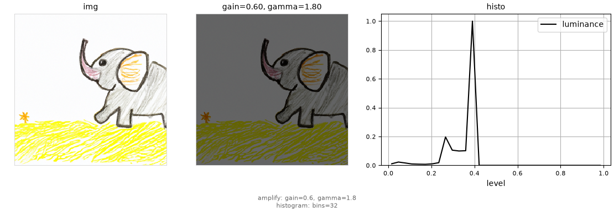
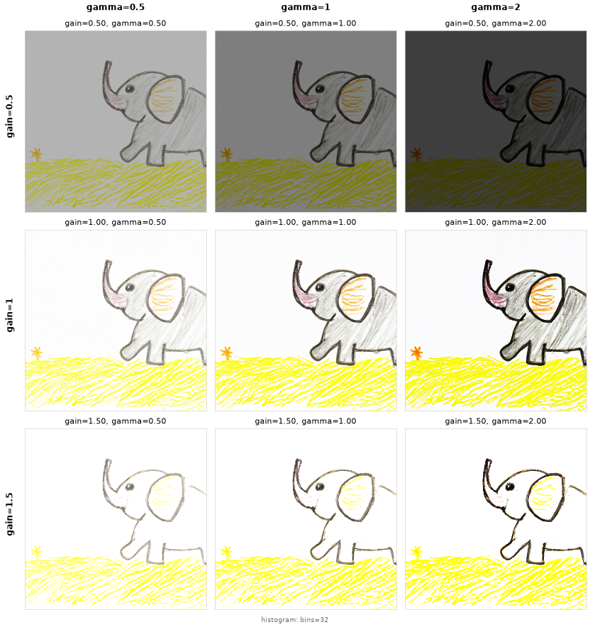

# Snapshots, sweeps and describe

A GUI window cannot be looked at from a terminal over SSH, from CI, or by a
coding agent. Headless mode already hands back the raw arrays; **snapshots**
render *what the window would show* — the output grid, the titles set with
`layout.style`, curves and tables — to a PNG file that can be opened and read
back. **Sweeps** do the same for several parameter values at once, and
**describe** lists the knobs.

All of it is pure headless (matplotlib's object API, no `pyplot`, no window),
works with any `gui=` value, and leaves the pipeline exactly as it was: the
parameter values passed to a snapshot apply to that call only.

## Pipelines

```python
import numpy as np
from PIL import Image

from interactive_pipe import Curve, interactive, interactive_pipeline, layout


@interactive(gain=(1.0, [0.0, 3.0]), gamma=(1.0, [0.3, 3.0]))
def amplify(img, gain=1.0, gamma=1.0):
    """Exposure and gamma."""
    layout.style("amplified", title=f"gain={gain:.2f}, gamma={gamma:.2f}")
    return np.clip(gain * img, 0.0, 1.0) ** gamma


@interactive(bins=(32, [8, 128]))
def histogram(img, bins=32):
    """Luminance histogram."""
    hist, edges = np.histogram(img.mean(axis=-1), bins=bins, range=(0.0, 1.0))
    centers = (edges[:-1] + edges[1:]) / 2
    return Curve([[centers, hist / hist.max(), "k-", "luminance"]], xlabel="level", ylim=(0.0, 1.05), grid=True)


@interactive_pipeline(gui="qt")  # any gui= value
def pipe(img):
    amplified = amplify(img)
    histo = histogram(amplified)
    return img, amplified, histo


img = np.asarray(Image.open("demo/images/elephant.png").convert("RGB"), dtype=np.float32) / 255.0
img = img[::2, ::2]  # 256 x 256

print(pipe.summary())  # controls, ranges, outputs
pipe.snapshot("docs/images/snapshot_example.png", img, gain=0.6, gamma=1.8)
pipe.sweep(
    "docs/images/snapshot_sweep.png", img, gain=[0.5, 1.0, 1.5], gamma=[0.5, 1.0, 2.0], output="amplified", dpi=80
)
```

`pipe.snapshot(...)` renders the whole layout, with the parameter values used
printed underneath:



`pipe.sweep(...)` runs the pipeline for every combination and builds a
contact sheet (two swept parameters: rows and columns):



`pipe.summary()` (text) and `pipe.describe()` (a JSON-serialisable dict) list
the inputs, the output layout, the filters in execution order and every
control with its kind, current value, range or choices:

```text
Pipeline 'pipe'
  inputs : img
  outputs: [img, amplified, histo]
Filters (execution order):
  amplify(img) -> amplified   [gain=1, gamma=1]
      Exposure and gamma.
  histogram(amplified) -> histo   [bins=32]
      Luminance histogram.
Controls:
  gain  slider(float) = 1 in [0, 3] step 0.03  -> amplify.gain
  gamma slider(float) = 1 in [0.3, 3] step 0.027  -> amplify.gamma
  bins  slider(int) = 32 in [8, 128] step 1  -> histogram.bins
```

### `snapshot(path, *inputs, **params)`

- `path`: PNG file (parent folders are created). `None` returns the image as
  an `(H, W, 3)` uint8 array instead (notebooks, tests).
- inputs: positional like a pipeline call, or `inputs={"img": ...}`. They can
  be omitted when the pipeline takes none, or to reuse the previous ones.
- parameter overrides: a keyword-argument name (`gain=2.0`, set in every
  filter having it), a control name, or `"filter.param"` for one filter
  (`**{"amplify.gain": 2.0}`). An unknown name raises `TypeError` with the
  available names and a close match. Values outside a slider range are
  clamped like the slider would (with a warning).
- `params={...}`: the same overrides as a dict, for parameter names that clash
  with the options below.
- `output=`: render only some outputs — a name, an index or a list of them.
- `figsize=`, `dpi=`, `title=`; `caption=False` hides the parameter caption
  (a string replaces it).
- `runs=N`: render the N-th run instead of the first (a pipeline keeping
  state in `context`: an accumulator, a simulation).
- A filter raising propagates as `FilterError`; the pipeline state is restored
  in every case (parameters, control values, layout, styles, last results).

Every snapshot, and every sweep cell, starts from a fresh context: `context`
back to what was given from outside (`context={...}` of the decorator or of a
call, not what filters wrote), key-bound events off, no cached result. A
picture therefore depends only on its inputs and parameters, not on the runs
before it; `runs=N` warms a stateful pipeline up from that start. See
[Testing](testing.md).

### `sweep(path, *inputs, **params)`

- A list, tuple or numpy array is a swept axis, a scalar is a fixed override
  for every cell: `pipe.sweep("s.png", img, gain=[0.5, 1, 2], bins=64)`.
- One swept parameter gives one row of labelled cells (a near-square grid
  beyond 6 values); two give a grid with row and column labels; more raise
  `ValueError`.
- `steps={"gain": 5}` sweeps a control over its declared range (5 evenly
  spaced values; every choice of a dropdown, both states of a checkbox).
- Range parameters (`RangeControl`) take `(lo, hi)` tuples as *one* value:
  sweep them with a list of pairs, `window=[(0.0, 0.5), (0.5, 1.0)]`.
- `output=`: the output shown in each cell (default: the only output, else
  the first image the swept parameters change, so `return img, out` shows
  `out`; else the last image); `output="all"` shows the whole layout in every
  cell.

## The outputs themselves: `.headless`

`pipe.headless(img, gain=2.0)` runs the pipeline without a window and returns
its outputs, whatever the `gui=` of the decorator: a tuple in the order of the
pipeline's `return` (a list of rows when it returns a 2D list; a
`layout.grid` call changes the display, not this). On a `gui=None` pipeline it
is the pipeline itself, so `pipe(img)` and `pipe.headless(img)` are the same.
It is a separate pipeline from the window's: its parameter values are its own.
Use it in tests, next to `snapshot` for the picture.

A filter's returned tuple is unpacked into the names its pipeline line
assigns (`a, b = split(img)`); a list assigned to one name stays one value
(`detections = detect(img)`, whatever its length).

## Single filters

Every `@interactive` filter gets the same entry points, through a throwaway
one-filter pipeline — no pipeline function needed
([issue #21](https://github.com/balthazarneveu/interactive_pipe/issues/21)):

```python
amplify.snapshot("amp.png", img, gain=2.0)
amplify.sweep("amp_sweep.png", img, gain=[0.5, 1, 2])
amplify.describe()  # amplify.describe(img) also names the outputs
amplify.interact(img)  # open the GUI on this filter alone
```

The decorated function stays a plain function (picklable, callable directly),
and these calls leave its controls connected to the pipelines using it, with
their values unchanged. A filter returning several values shows one cell per
value.

## Without editing the script: `INTERACTIVE_PIPE_SNAPSHOT`

```bash
INTERACTIVE_PIPE_SNAPSHOT=shots/ python demo/image_analysis_demo.py
# interactive_pipe: snapshot of 'image_analysis_pipeline' written to shots/image_analysis_pipeline.png
```

When the variable is set, calling a GUI-decorated pipeline renders the
snapshot and returns the results instead of opening a window — whatever its
`gui=` value, and over `INTERACTIVE_PIPE_GUI`. The value is a PNG path
(`{name}` is replaced by the pipeline function name) or a folder (ending with
`/`, or existing). `gui=None` pipelines are unaffected; `filter.interact()`
honours it too.

## Working with a coding agent

An agent cannot see a Qt window, but it can read a PNG. The loop:

1. **`describe()`** (or `summary()`) — learn the controls, their ranges and
   the outputs.
2. **`snapshot("out.png", img, **params)`** — render the result.
3. **Read the PNG** and judge it: wrong colours, clipped values, a curve out
   of its limits, an exception message.
4. **Adjust** the filter code or the parameter values, snapshot again.
5. **`sweep("sweep.png", img, param=[...])`** — compare values side by side to
   choose defaults and ranges, or check a fix holds over the whole range.

To look at a user's unmodified GUI script, run it with
`INTERACTIVE_PIPE_SNAPSHOT=shots/`, or with `interactive-pipe snapshot script.py`
(one PNG per pipeline call, see [Command line](command-line.md#snapshot-look-at-a-gui-script-without-a-display)).
