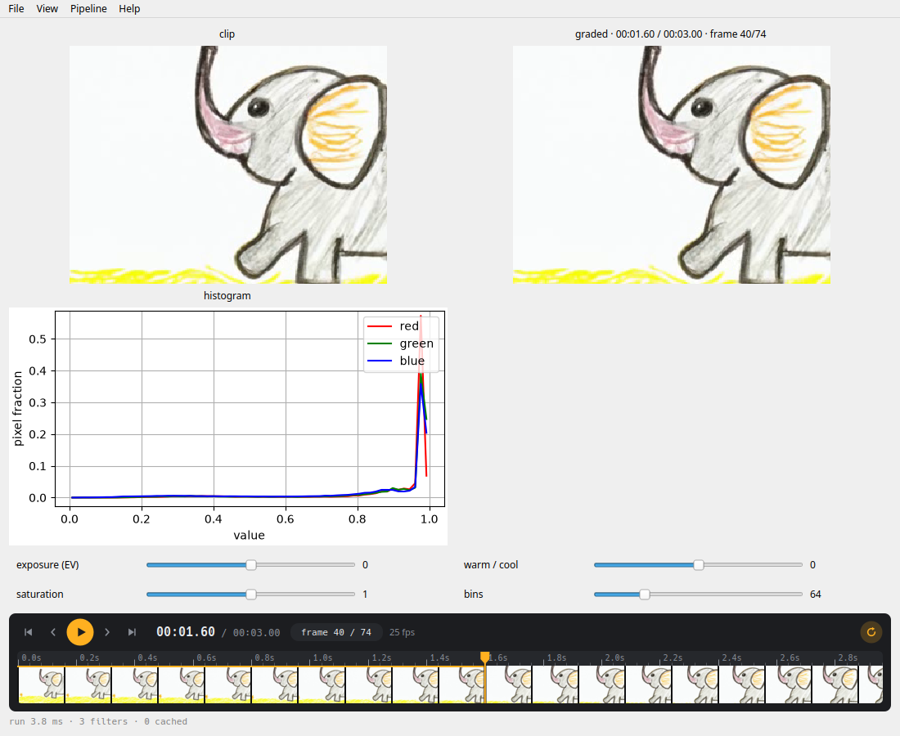

# Video inputs & timeline

Write the pipeline for **one frame**, give it a **`Video`**: the window gets a
timeline at the bottom (film strip, play / pause, step, timecode) and every
filter receives the frame under the playhead.



```python
import numpy as np

from interactive_pipe import Video, interactive, interactive_pipeline


@interactive(gain=(1.0, [0.0, 2.0]))
def amplify(frame, gain=1.0):
    return np.clip(frame * gain, 0.0, 1.0)


@interactive_pipeline(gui="qt")
def brighten(frame):
    bright = amplify(frame)
    return frame, bright


frames = np.random.default_rng(0).uniform(size=(50, 64, 96, 3)).astype(np.float32)
brighten(Video(frames, fps=25))  # a window with a timeline
```

Nothing else changes: the filters still take an array, the sliders still
apply to what is on screen, and the same function called with a plain image
still works without a timeline.

## What a `Video` can be made from

| source | example |
|---|---|
| video file (OpenCV; `.gif` also with Pillow only) | `Video("clip.mp4")` |
| folder of images, glob pattern, list of paths | `Video("frames/")`, `Video("shots/*.png")` |
| numpy array `(T, H, W)` / `(T, H, W, C)`, list of arrays | `Video(stack, fps=30)` |
| torch tensor `(T, C, H, W)` / `(T, H, W, C)`, list of tensors | `Video(tensor)` |
| iterator / generator of frames, opened `cv2.VideoCapture` | `Video(simulate(), max_frames=200)` |

Files and image folders are decoded lazily (only the frames you visit, the
last ones kept in a small cache), as `[0, 1]` float RGB like `Image.load_image`.
Arrays and tensors are handed over as they are. Torch frames become numpy
`(H, W[, C])` arrays unless you pass `to_numpy=False`, which hands the tensor
slices to your model filter (see `demo/video_compare_demo.py`).

Other options: `fps=` (default: the file's, else 25), `start=`, `stop=`,
`step=` (keep `frames[start:stop:step]`), `max_frames=` for streams.

## The timeline

| | Qt and Dear PyGui | matplotlib / Gradio / notebook |
|---|---|---|
| widget | a panel at the bottom: transport and timecode, then a full-width film strip | frame slider |
| play / pause | <kbd>Space</kbd> or ▶ | – |
| step one frame | <kbd>←</kbd> <kbd>→</kbd> or ‹ › | slider |
| seek | click / drag on the strip | slider |
| zoom | scroll on the strip (shift + scroll pans, double-click shows it all) | – |

Playback runs at the video frame rate. When the pipeline is slower than the
video, frames are skipped like a player does (the display never lags behind).
The ⟳ button toggles looping. Zoomed in, the strip shows the frames one by
one, a thin bar under it shows which part of the video is visible, and the
view follows the playhead during playback. A `KeyboardControl` or a context
event already bound to space or the arrows keeps them.

### Showing, folding or hiding it

`Video(..., timeline=...)` chooses how the Qt and Dear PyGui windows show
the timeline (the first `Video` input decides):

| `timeline=` | |
|---|---|
| `"shown"` (default) | the whole panel |
| `"collapsible"` | a ⌄ button on the right folds the panel to its transport row, giving the room back to the images |
| `"collapsed"` | collapsible, folded at start |
| `"hidden"` | no panel: <kbd>Space</kbd> and <kbd>←</kbd> <kbd>→</kbd> still play and step |

<!-- code: continue -->
```python
brighten(Video(frames, fps=25, timeline="hidden"))  # keyboard only
```

The panel takes the window's light or dark look on Qt (Dear PyGui is dark).

The timeline is an ordinary control named **`frame`**: the call can set the
starting frame, and snapshots, sweeps, tuning files and sessions see it too.

<!-- code: continue -->
```python
clip = Video(frames, fps=25)
brighten(clip, frame=20)  # opens at frame 20
brighten.headless(clip, frame=10, gain=1.5)  # outputs at frame 10, no window
brighten.snapshot("/tmp/frame10.png", clip, frame=10)
brighten.sweep("/tmp/contact_sheet.png", clip, frame=[0, 10, 20, 30, 40])
```

`export_animation` renders the whole video, at its frame rate, when the
pipeline has a `Video` input. Press <kbd>V</kbd> in the window to do the same.

<!-- code: continue -->
```python
from interactive_pipe import export_animation

export_animation(brighten.headless, "/tmp/brighten.gif", output=1)  # the second output
```

## Reading the position in a filter

Filters read the timeline position from the context: `context["timeline"]`
is a `Timeline` with `frame`, `time` (seconds), `fps`, `n_frames`,
`duration` and `progress` (0 to 1). Printed, it reads
`00:01.20 / 00:04.00 · frame 30/99`.

```python
import numpy as np

from interactive_pipe import Video, context, interactive, interactive_pipeline, layout


@interactive()
def fade_in(frame):
    timeline = context["timeline"]
    layout.style("faded", title=str(timeline))
    return frame * min(timeline.time / 1.0, 1.0)  # 1 s fade from black


@interactive_pipeline(gui="qt")
def fading(frame):
    faded = fade_in(frame)
    return faded


fading(Video(np.ones((50, 32, 32, 3), np.float32), fps=25))
```

## Several videos, one timeline

Give several `Video` inputs: they share the timeline. When their frame rates
differ, each shows the frame matching the current *time*: the timeline runs
at the first video's frame rate and lasts as long as the longest one.

<!-- code: skip needs two video files -->
```python
compare(Video("reference.mp4"), Video("encoded_15fps.mp4"))
```

## Temporal filters: `window=`

A filter that needs the past (frame differences, temporal denoising, motion)
takes a `Video(..., window=k)`: it receives the `k` frames ending at the
current one, stacked on a first axis `(k, H, W[, C])` (at the start of the
video the first frame is repeated). Give the same frames twice to get both
the current frame and the window:

```python
import numpy as np

from interactive_pipe import Video, interactive, interactive_pipeline


@interactive(threshold=(0.1, [0.0, 0.5]))
def motion(frames, threshold=0.1):
    return (np.abs(frames[-1] - frames[0]).max(axis=-1) > threshold).astype(np.float32)


@interactive_pipeline(gui="qt")
def detect(frame, frames):
    mask = motion(frames)
    return frame, mask


stack = np.random.default_rng(0).uniform(size=(30, 48, 64, 3)).astype(np.float32)
detect(Video(stack), Video(stack, window=3), frame=10)
```

`clip.with_window(3)` is the same video (sharing its decoded frames) with a
window.

## How it works

When an input is a `Video`, the pipeline puts a small filter in front of the
others (`video_<input name>`, shown by `describe()` and the graph) that reads
the frame from the `Video` and writes it in place of the input. A
`TimelineControl` drives that filter. So the cache recomputes only what
follows the frame when the playhead moves (use `cache=True` or `"graph"` so
slider changes do not decode the frame again), and every tool that knows
controls knows the timeline.

## Examples

- `demo/video_grading_demo.py`: grade a video file (exposure, saturation,
  white balance) with a histogram. The title shows the timecode.
- `demo/video_motion_demo.py`: motion detection on a numpy simulation with
  `window=3`, with boxes drawn on the moving objects.
- `demo/video_compare_demo.py`: a restoration model fed with torch tensors
  at 12 fps, compared with a 24 fps reference: wipe, error map, PSNR.
