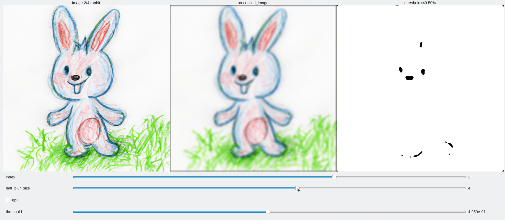
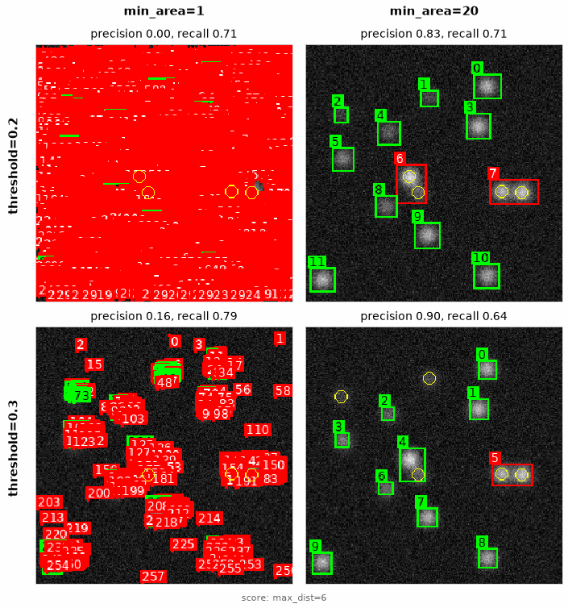
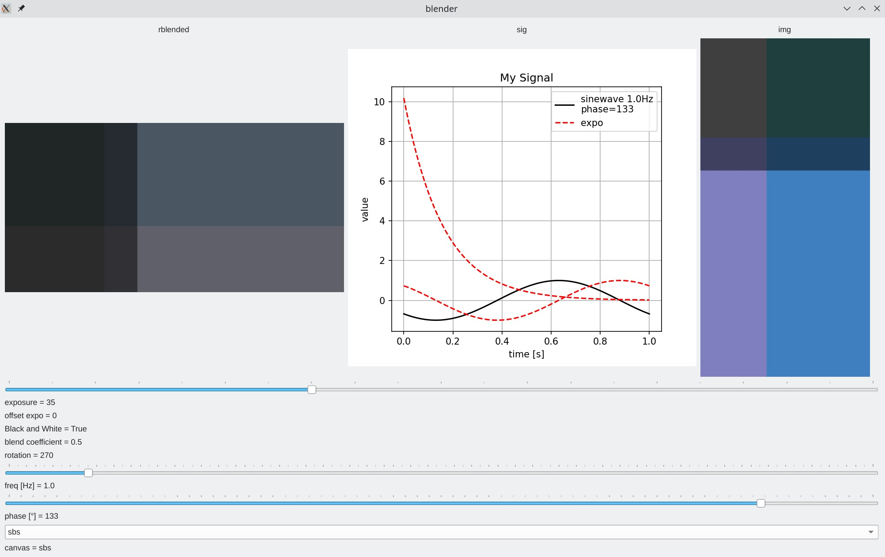
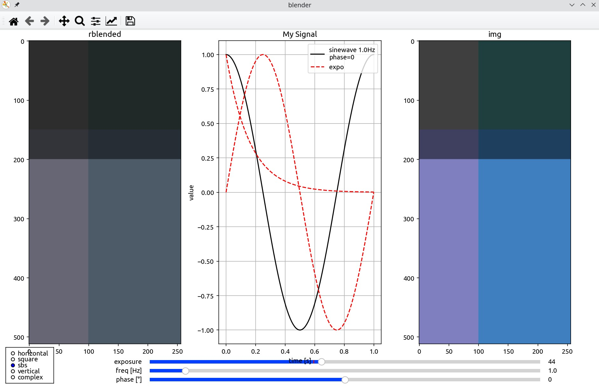
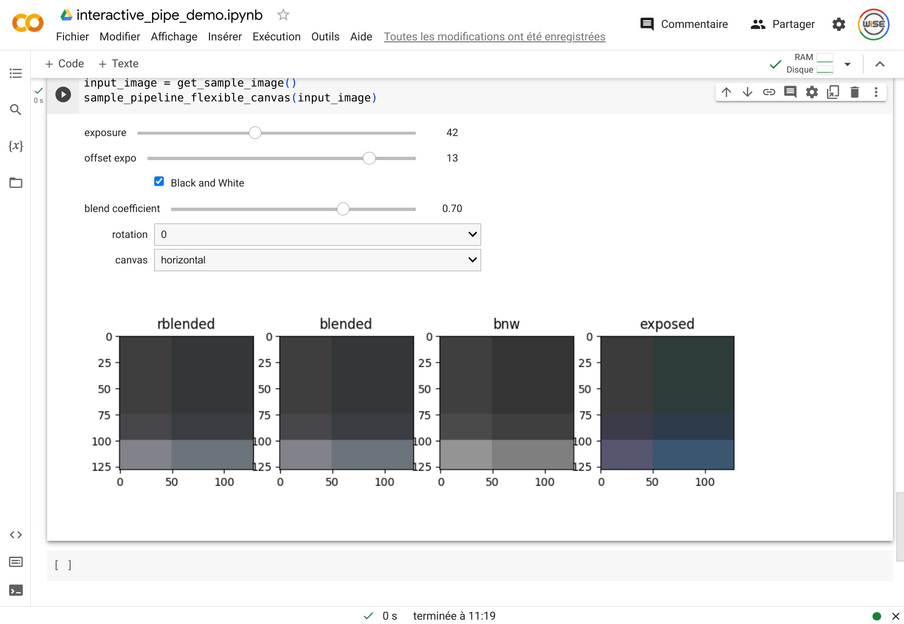
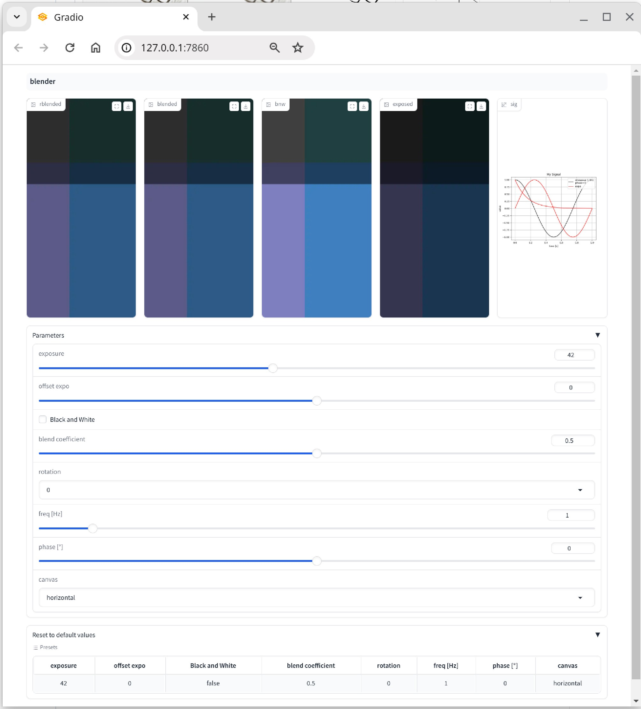

<div align="center">


[](https://pypi.org/project/interactive-pipe/)
[](https://pypi.org/project/interactive-pipe/)
[](https://github.com/balthazarneveu/interactive_pipe/blob/master/LICENSE)
[](https://balthazarneveu.github.io/interactive_pipe/)
[](https://github.com/balthazarneveu/interactive_pipe/actions/workflows/pytest.yaml)

**📖 [Documentation](https://balthazarneveu.github.io/interactive_pipe/)**

</div>

# interactive_pipe

**Turn plain python processing functions into an interactive GUI app — without writing a single line of GUI code.**

```bash
pip install interactive-pipe
```

- Develop an algorithm while debugging visually with plots, checking robustness and continuity to parameter changes.
- Magically create a graphical interface to demonstrate a concept or tune your algorithm.
- Keep your algorithm library untouched: interactivity is added by decoration, not by rewriting.
- The same pipeline runs headless for batch processing and tests.



## Quick taste

```python
from interactive_pipe import interactive, interactive_pipeline
import numpy as np


@interactive(coeff=(1.0, [0.5, 2.0], "exposure"), bias=(0.0, [-0.2, 0.2]))
def exposure(img, coeff=1.0, bias=0.0):
    return img * coeff + bias


@interactive(blend_coeff=(0.5, [0.0, 1.0]))
def blend(img0, img1, blend_coeff=0.5):
    return (1 - blend_coeff) * img0 + blend_coeff * img1


@interactive_pipeline(gui="qt")  # or "dpg" (Dear PyGui), "mpl", "nb" (Jupyter/Colab), "gradio"
def pipe(img):
    exposed = exposure(img)
    blended = blend(img, exposed)
    return exposed, blended


pipe(np.array([0.0, 0.5, 0.8]) * np.ones((256, 512, 3)))
```

Calling `pipe(...)` opens a window with sliders for every declared parameter. 🎉

## Features

- **Controls from type hints**: `gain: Annotated[float, (0.0, 3.0)] = 1.0` is a slider, `Literal["dark", "light"]` a dropdown — or declare them in `@interactive(...)`.
- **Figures and overlays**: return a matplotlib `Figure`, a heatmap with a colorbar, or draw boxes, points and masks with `interactive_pipe.draw`.
- **Mouse input**: `PointControl` / `RegionControl` — click a point or shift-drag a region on an image.
- **Video inputs**: `my_pipeline(Video("clip.mp4"))` — the pipeline written for one frame gets a timeline (play / pause, scrub, step); videos from files, image folders, numpy arrays, torch tensors or generators.
- **Snapshots and sweeps**: `pipe.snapshot("out.png", img, coeff=1.5)` renders what the window shows, `pipe.sweep("sweep.png", img, coeff=[0.5, 1.0, 2.0])` compares values side by side — no display needed (SSH, CI, agents).
- **Command line**: `interactive-pipe check | snapshot | sweep | describe my_script.py` on an unmodified GUI script; `interactive-pipe doctor` explains why no window shows up.
- **Coding agents**: `interactive-pipe skill --install` teaches Claude Code (or any agent, `interactive-pipe skill`) to build pipelines and check them by reading snapshots.



*A blob detector swept over two parameters with `interactive-pipe sweep`, from the [scientific gallery](https://balthazarneveu.github.io/interactive_pipe/gallery/).*

## Backends

| *PyQt / PySide* | *Matplotlib* | *Jupyter / Colab* | *Gradio* |
|:-----:|:------:|:----:|:----:|
| `gui="qt"` | `gui="mpl"` | `gui="nb"` | `gui="gradio"` |
|  |  |  |  |

Plus a GPU-rendered [Dear PyGui](https://github.com/hoffstadt/DearPyGui) window (`gui="dpg"`, `pip install "interactive-pipe[dpg]"`) and headless mode (`gui=None`) for batch processing. Full feature matrix in the [backends docs](https://balthazarneveu.github.io/interactive_pipe/getting-started/backends/).

## Learn more

- 📖 [Documentation](https://balthazarneveu.github.io/interactive_pipe/) — quickstart, guides, API reference
- 🤖 Agent-friendly docs: [llms.txt](https://balthazarneveu.github.io/interactive_pipe/llms.txt) / [llms-full.txt](https://balthazarneveu.github.io/interactive_pipe/llms-full.txt)
- 🎓 [Interactive tutorial on Hugging Face](https://huggingface.co/spaces/balthou/interactive-pipe-tutorial)
- 📈 [Figures, heatmaps & overlays](https://balthazarneveu.github.io/interactive_pipe/guide/figures-and-overlays/) — matplotlib figures, colorbars, `interactive_pipe.draw` for boxes, points and masks
- 📸 [Snapshots & sweeps](https://balthazarneveu.github.io/interactive_pipe/guide/snapshots/) — render what the GUI shows to a PNG, headless (CI, SSH, coding agents)
- 🖱️ [Mouse input](https://balthazarneveu.github.io/interactive_pipe/guide/mouse-input/) — clicked points and dragged regions
- 🎞️ [Video inputs & timeline](https://balthazarneveu.github.io/interactive_pipe/guide/video/) — a timeline for any `Video` input, temporal filters, synced videos
- 💻 [Command line & coding agents](https://balthazarneveu.github.io/interactive_pipe/guide/command-line/) — `interactive-pipe check / snapshot / sweep / describe / skill / doctor`
- 🗒️ [Examples](https://balthazarneveu.github.io/interactive_pipe/guide/examples/) — 27 demo scripts, a [scientific gallery](https://balthazarneveu.github.io/interactive_pipe/gallery/), Colab notebooks, a Raspberry Pi jukebox
- 📋 [Changelog](https://github.com/balthazarneveu/interactive_pipe/blob/master/CHANGELOG.md)
- 🤝 [Contributing](https://github.com/balthazarneveu/interactive_pipe/blob/master/CONTRIBUTING.md)
